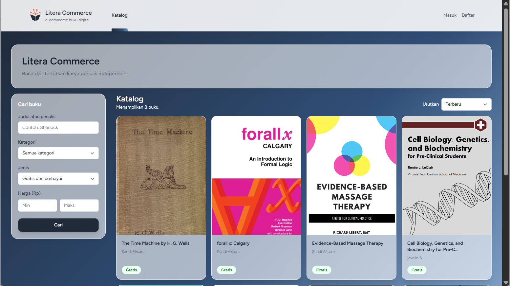
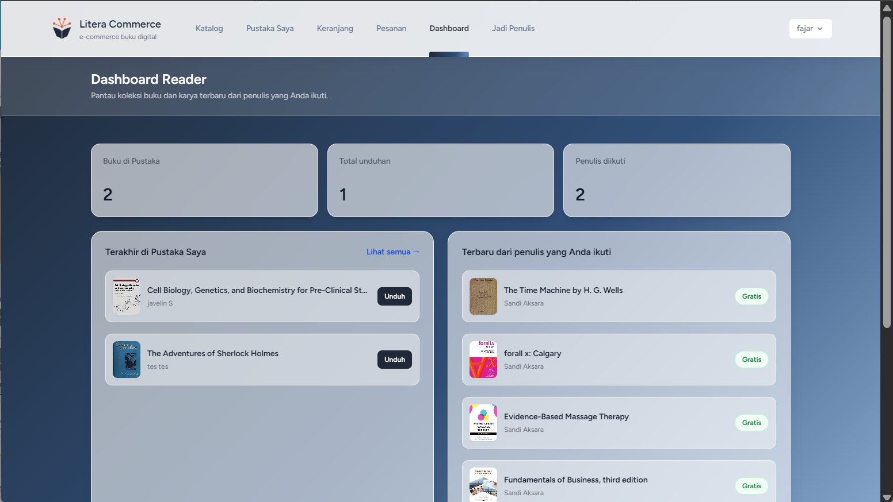
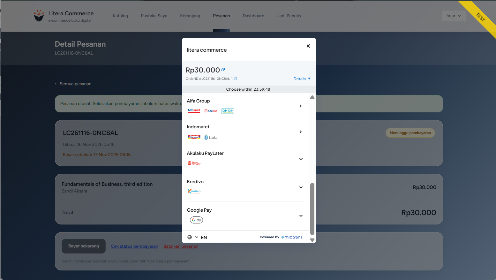
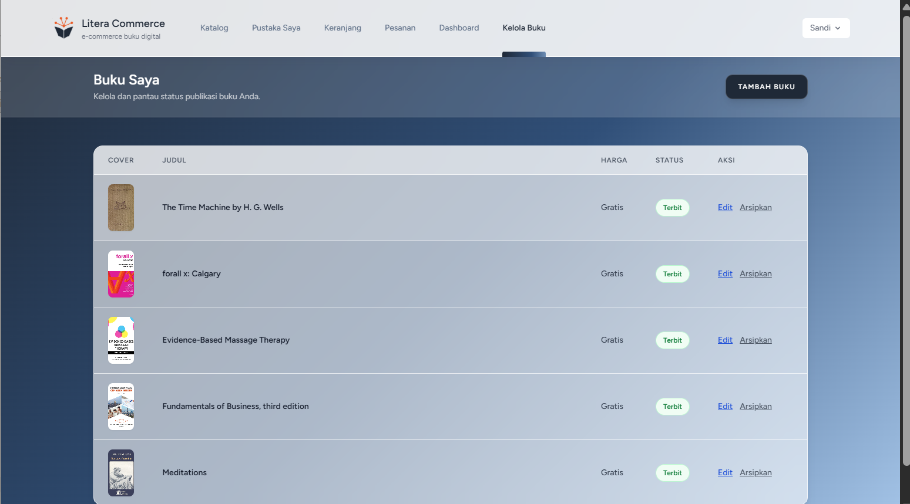

<p align="center">
  
</p>

<h1 align="center">LiteraCommerce</h1>

<p align="center">
  Marketplace buku digital dan platform self-publishing untuk penulis indie
</p>

<p align="center">
  
  
  
  
</p>

---

## Tentang Proyek

**LiteraCommerce** adalah platform web untuk penulis indie yang ingin menerbitkan dan menjual karyanya sendiri tanpa lewat penerbit besar, sekaligus tempat pembaca menemukan dan membeli buku digital.

Penulis mengunggah buku dan menentukan harga. Admin meninjau setiap buku berbayar sebelum tayang di katalog. Pembaca membayar lewat Midtrans, lalu bukunya langsung masuk ke **Pustaka Saya** dan bisa diunduh. Setiap penjualan mencatat bagi hasil untuk penulis secara otomatis.

Proyek ini dibangun sebagai tugas mata kuliah semester 5 (Manajemen Informatika, Politeknik Negeri Padang).

### Jenis web


**Kategori** Marketplace produk digital (e-book) 
**Sifat** Web dinamis *full-stack* berbasis web application dengan login dan tiga peran pengguna 
**Model bisnis**  Banyak penjual (penulis) di satu platform, dengan admin sebagai perantara dan bagi hasil 90% untuk penulis, 10% untuk platform 

Berbeda dari toko online biasa (satu penjual), di sini banyak penulis menjual bukunya masing-masing, dan platform meninjau serta membagi hasil penjualannya. Produknya digital, jadi tidak ada pengiriman. Gantinya ada Pustaka Saya dan unduhan yang hanya bisa diakses pemiliknya.

---

## Tampilan

<table>
  <tr>
    <td width="50%"><br><sub><b>Katalog buku</b></sub></td>
    <td width="50%"><br><sub><b>Dashboard pembaca</b></sub></td>
  </tr>
  <tr>
    <td width="50%"><br><sub><b>Pembayaran Midtrans (sandbox)</b></sub></td>
    <td width="50%"><br><sub><b>Tinjau buku oleh admin</b></sub></td>
  </tr>
</table>

---

## Aturan Bisnis Singkat

- Buku gratis langsung terbit. **Buku berbayar menunggu persetujuan admin** sebelum tampil di katalog.
- Penulis tidak bisa membeli bukunya sendiri, dan satu buku tidak bisa dimiliki dua kali oleh pembaca yang sama.
- Satu buku tidak bisa berada di dua pesanan yang sama-sama belum dibayar.
- Pesanan yang tidak dibayar dalam 24 jam kedaluwarsa otomatis.
- Buku yang di-takedown tidak bisa diunduh lagi oleh pemiliknya sampai dipulihkan admin.


---

## Fitur Utama

### Pembaca
- Menjelajahi katalog buku, dengan pencarian dan filter kategori
- Pratinjau PDF sebelum membeli
- Mengikuti penulis favorit dan melihat karya terbarunya di dashboard
- Mengambil buku gratis, atau membeli buku berbayar lewat keranjang dan checkout
- **Pustaka Saya:** koleksi buku yang sudah dimiliki, dengan unduhan yang hanya bisa diakses pemiliknya
- Riwayat dan status pesanan

### Penulis
- Mendaftar sebagai penulis dengan menyetujui pernyataan hak distribusi
- Mengelola buku: tambah, edit, terbitkan, arsipkan, dan terbitkan ulang
- Mengunggah cover, file PDF lengkap, dan PDF pratinjau
- Mengatur harga, kategori, serta status hak distribusi (karya sendiri, Creative Commons, domain publik, atau dengan izin)
- Mengedit profil penulis (nama pena, bio, foto) dan membagikan tautan buku
- Dashboard ringkasan buku, unduhan, dan pengikut

### Admin
- Meninjau buku berbayar sebelum tayang: **setujui** atau **tolak** dengan alasan
- **Takedown** buku yang melanggar dan memulihkannya kembali
- Membuka file pratinjau dan PDF lengkap untuk keperluan tinjauan
- Melihat dan menindaklanjuti laporan pembaca
- Dashboard statistik pengguna dan buku

### Pembayaran
- Integrasi **Midtrans Snap (sandbox)** lewat popup pembayaran
- Pesanan menunggu pembayaran dengan batas waktu 24 jam, lalu kedaluwarsa otomatis
- Cek status pembayaran langsung ke Midtrans
- Setelah lunas, buku otomatis masuk Pustaka Saya
- Bagi hasil dicatat per transaksi: harga dan persentase royalti dibekukan saat pesanan dibuat, sehingga perubahan pengaturan nanti tidak memengaruhi transaksi lama

---

## Desain UI

Dirancang agar **sederhana dan mudah digunakan**:

- **Alur singkat dan jelas:** dari katalog sampai buku siap diunduh hanya lima langkah (pilih, keranjang, checkout, bayar, unduh)
- **Tampilan seragam** di semua halaman dan semua peran: setiap halaman punya judul dan keterangan singkat di header
- **Navigasi yang mudah dikenali:** menu aktif ditandai garis gradien, dan menu menyesuaikan peran sehingga hanya menampilkan yang relevan
- **Umpan balik yang jelas:** status berwarna, pesan sukses dan error yang mudah dipahami, termasuk alasan saat buku ditolak admin
- **Responsif** di HP maupun desktop, dengan gaya *glassmorphism* dan gradien navy ke biru muda yang bersih dan tidak ramai

---

## Teknologi

| Bagian | Teknologi |
|---|---|
| Backend | Laravel 13, PHP 8.3+ |
| Database | MariaDB (atau MySQL) |
| Autentikasi | Laravel Breeze, dengan middleware peran (reader, author, admin) |
| Frontend | Blade, Tailwind CSS, Alpine.js, Vite |
| Pembayaran | Midtrans Snap (`midtrans/midtrans-php`), mode sandbox |
| Penyimpanan file | Disk privat Laravel (file buku tidak bisa diakses lewat URL publik) |

---

## Cara Menjalankan

**Prasyarat:** PHP 8.3+, Composer, Node.js, dan MariaDB atau MySQL.

```bash
# 1. Unduh proyek
git clone https://github.com/fajarnugrahaeditya/marketplace_buku.git
cd marketplace_buku

# 2. Pasang dependensi
composer install
npm install

# 3. Siapkan environment
copy .env.example .env        # di Mac/Linux: cp .env.example .env
php artisan key:generate
```

Buka `.env`, lalu atur koneksi database. Contoh:

```env
DB_CONNECTION=mariadb
DB_HOST=127.0.0.1
DB_PORT=3306
DB_DATABASE=marketplace_buku
DB_USERNAME=root
DB_PASSWORD=
```

Buat database kosong dengan nama yang sama, lalu lanjutkan:

```bash
# 4. Buat tabel dan data awal (kategori, pengaturan, akun admin)
php artisan migrate --seed

# 5. Tautkan folder penyimpanan publik
php artisan storage:link

# 6. Bangun aset frontend, lalu jalankan server
npm run build
php artisan serve
```

Buka `http://127.0.0.1:8000`.

### Akun admin awal

Seeder membuat satu akun admin dengan email `admin@example.com`. Kata sandinya ada di `database/seeders/AdminSeeder.php`. **Ganti keduanya sebelum dipakai di luar uji coba.**

### Mengaktifkan pembayaran Midtrans (sandbox)

Pembayaran memakai **Midtrans Sandbox**, yaitu mode uji coba tanpa uang asli.

1. Daftar akun gratis di Midtrans, lalu buka dashboard mode **Sandbox**.
2. Di menu **Settings, Access Keys**, buat Server Key dan ambil Client Key.
3. Isi di `.env`:

   ```env
   MIDTRANS_SERVER_KEY=
   MIDTRANS_CLIENT_KEY=
   MIDTRANS_SIGNATURE_SECRET_KEY=
   MIDTRANS_IS_PRODUCTION=false
   ```

4. Jalankan `php artisan config:clear`.

> **Jangan pernah meng-commit file `.env`.** Kunci Midtrans bersifat rahasia.

Untuk mencoba pembayaran, ikuti data uji di dokumentasi sandbox Midtrans (kartu uji, simulator pembayaran).

> **Pengguna Windows:** kalau muncul error `SSL certificate ... unable to get local issuer certificate` saat memanggil Midtrans, unduh `cacert.pem` dari curl.se, lalu isi `curl.cainfo` dan `openssl.cafile` di `php.ini` dengan jalur file tersebut dan mulai ulang server.

---

## Status dan Rencana Pengembangan

Proyek ini masih dikembangkan. Yang sudah berjalan: peran pengguna, katalog, kelola dan tinjau buku, Pustaka Saya, keranjang, checkout, dan pembayaran Midtrans sandbox.

Rencana berikutnya:
- Webhook notifikasi Midtrans beserta verifikasi tanda tangan
- Review dan rating buku
- Form laporan buku dari pembaca
- Saldo royalti dan penarikan untuk penulis
- Pengujian otomatis untuk alur pembayaran
- Deploy ke server online

---

## Pembuat

**Fajar Nugraha Editya**
Mahasiswa Manajemen Informatika, Politeknik Negeri Padang

[GitHub](https://github.com/fajarnugrahaeditya)